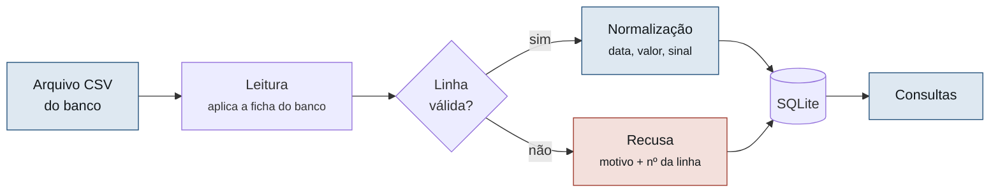

<div align="center">

# Statement Analyzer

**Envie um extrato bancário. Faça perguntas sobre ele.**


</div>

Especificação técnica completa: **[`docs/SPEC.md`](docs/SPEC.md)**

---

## O projeto

O banco registra tudo que entrou e saiu da conta, mas entrega isso como um arquivo longo, com
descrições geradas por máquina (`PAG*MERC CENTRAL 03/09`) e sem nenhum resumo. Na prática
ninguém lê o próprio extrato, e perguntas simples ficam sem resposta.

Pior: não existe formato único de exportação — cada banco escreve data, valor decimal, sinal
de saída e nomes de coluna de um jeito.

**O Statement Analyzer resolve as duas coisas.** Você envia o arquivo, ele entende o formato
do banco pela ficha declarada, normaliza os lançamentos para um modelo único e passa a
responder consultas sobre eles.



Uma linha com defeito **não derruba o arquivo**: é recusada individualmente, com motivo e
número da linha, e a leitura continua (RN05).

---

## Funcionalidades

| Método | Rota | Descrição |
|:---|:---|:---|
| `POST` | `/extratos` | Envia o arquivo e devolve o resultado da leitura |
| `GET` | `/extratos` | Lista os extratos enviados |
| `GET` | `/extratos/{id}` | Detalhes do extrato e seus lançamentos |
| `DELETE` | `/extratos/{id}` | Apaga o extrato, seus lançamentos e suas recusas |

### Consultas

| Rota | Responde |
|:---|:---|
| `GET /extratos/{id}/resumo` | Entradas, saídas, saldo, média diária e período |
| `GET /extratos/{id}/saldo` | Saldo final, se ficou negativo, saldo mínimo e sua data |
| `GET /extratos/{id}/maior-entrada` | O maior valor que entrou |
| `GET /extratos/{id}/maior-despesa` | O maior valor que saiu |
| `GET /extratos/{id}/top-despesas?n=10` | As N maiores saídas |
| `GET /extratos/{id}/por-semana` | Entradas, saídas e saldo por semana |
| `GET /extratos/{id}/dias-no-negativo` | Quantos dias no vermelho, e quais |
| `GET /extratos/{id}/repetidos` | Gastos que se repetem no período |

### Fora do escopo da v1.0.0

Categorização de gastos · metas e orçamento · comparação com despesas planejadas ·
Open Finance · múltiplas moedas · login e múltiplos usuários · interface web além do mínimo
para demonstração.

---

## Como executar

Pré-requisito: **Docker**. Nada mais precisa estar instalado.

```bash
git clone https://github.com/<organizacao>/statement-analyzer.git
cd statement-analyzer

docker compose up api            # API em http://localhost:8000 (docs em /docs)
docker compose run --rm tests    # suíte de testes completa
```

---

## Colaboração com IA

**Ferramenta:** a definir entre Claude Code, Codex CLI, Cursor e Antigravity. Qualquer que
seja a escolha, o agente é regido pelo [`CLAUDE.md`](CLAUDE.md) na raiz do repositório, que o
obriga a seguir a `docs/SPEC.md` — para Cursor, o mesmo conteúdo é espelhado em
`.cursorrules`; para Codex CLI, em `AGENTS.md`.

**Uso no fluxo SDD:** a especificação é escrita primeiro pela equipe; o agente implementa a
partir dela; o harness valida; o que os testes revelarem ambíguo volta como refinamento na
`docs/SPEC.md` §8. Todo código gerado passa por Pull Request com revisão humana de outro
integrante — nenhum merge acontece sem suíte verde.

**Prompts relevantes** ficam versionados em [`docs/prompts/`](docs/prompts/).

<details>
<summary>Exemplo de prompt usado e resultado obtido</summary>

```
Implemente a unidade U3 (app/regras.py) conforme docs/SPEC.md §4 e §7,
com a interface definida na Issue #5. Depois rode o harness e me mostre
o resultado. Não modifique os testes.
```

**Resultado:** motor de normalização gerado cobrindo RN01–RN06. Ajuste manual necessário em
RN04 — o agente arredondava valores de três casas em vez de recusar a linha; detectado pelo
teste `test_precisao_excedente_recusa_a_linha`. Ver PR #«n».
</details>

---

## Decisões arquiteturais (ADRs)

### ADR-001 — Regras de negócio isoladas da camada HTTP

**Contexto:** precisamos testar as regras rapidamente e poder trocar a camada de apresentação
nas próximas entregas. Testes que sobem servidor são lentos e frágeis.
**Decisão:** motor puro em `app/regras.py` e `app/consultas.py`, proibidos de importar FastAPI
ou fazer I/O; `app/api.py` apenas traduz HTTP.
**Consequências:** 80% dos testes rodam em milissegundos, sem rede. Em troca, exige disciplina
de revisão para nenhuma dependência de HTTP vazar para dentro do motor.

### ADR-002 — Fichas de banco declarativas em JSON

**Contexto:** três bancos na v1.0.0, cada um com colunas, separadores, encoding e convenção de
sinal diferentes — e mais bancos depois. Condicionais no núcleo tornariam cada banco novo um
risco para os já existentes.
**Decisão:** o formato de cada banco é um arquivo JSON em `app/fichas/`, consumido por um
leitor único.
**Consequências:** adicionar um banco é adicionar dado, não código, e os testes dos bancos
existentes seguem válidos. Formatos que não caibam no vocabulário da ficha exigirão estender o
esquema.

### ADR-003 — Valores monetários em centavos inteiros

**Contexto:** ponto flutuante introduz erro de arredondamento (`0.1 + 0.2 = 0.30000000000000004`),
inaceitável em sistema cujo propósito é conferência.
**Decisão:** inteiro em centavos em todo o fluxo, do parser ao JSON de resposta.
**Consequências:** soma e comparação exatas, e SQLite armazena inteiros nativamente. A
formatação para exibição fica na borda, a cargo do cliente da API.

### ADR-004 — Persistência em SQLite

**Contexto:** o sistema é monousuário por escopo e o volume é de milhares de linhas. Postgres
somaria um serviço ao compose, espera de readiness e limpeza de tabelas entre testes.
**Decisão:** SQLite em arquivo, com banco em memória nos testes.
**Consequências:** um serviço a menos e testes rápidos e isolados. Se o sistema virar
multiusuário será preciso migrar — o acesso a dados está isolado em `app/db.py` para tornar
isso viável.

### ADR-005 — Recusar a linha em vez de adivinhar o formato

**Contexto:** `03/04/2026` pode ser 3 de abril ou 4 de março; valor com três casas decimais
pode ser erro de exportação ou precisão real. Uma heurística acertaria em alguns arquivos e
erraria em silêncio em outros.
**Decisão:** recusar a linha, registrando motivo e número, sempre que o dado não casar com a
ficha declarada.
**Consequências:** o sistema falha de forma visível e auditável em vez de produzir números
errados — aceitável porque o propósito é conferência. O custo é exigir ficha correta antes da
primeira leitura.

### ADR-006 — Docker como ambiente de referência, não de desenvolvimento

**Contexto:** cinco integrantes em sistemas operacionais diferentes, e o projeto depende de
encoding, locale e interpretação de data — exatamente o que varia entre máquinas.
**Decisão:** desenvolvimento local com dependências travadas; Docker obrigatório antes de
abrir PR e na entrega.
**Consequências:** ciclo rápido no dia a dia e reprodutibilidade verificável na entrega. Exige
manter as duas definições de dependência em sincronia.

---

## Evidências de execução

Log da última execução da suíte: [`logs_testes.txt`](logs_testes.txt), gerado com

```bash
docker compose run --rm tests | tee logs_testes.txt
```

---

## Equipe

| Integrante | RA |
|---|:---|
| Diego de Souza | 22352472 |
| Felipe Marinho | 22353607 |
| Gustavo Lourenço | 22350665 |
| Italo Henrique Lins Carneiro | 22350066 |
| João Caio Dutra Gontijo | 22352975 |

A divisão de tarefas está nas [Issues](../../issues), com responsável atribuído em cada uma.
As unidades do sistema estão descritas em [`docs/SPEC.md`](docs/SPEC.md) §7.

---

<div align="center">

Projeto acadêmico — **Bootcamp III**, Turma B<br>
Centro Universitário de Brasília (CEUB) — 2026/2<br>

</div>
