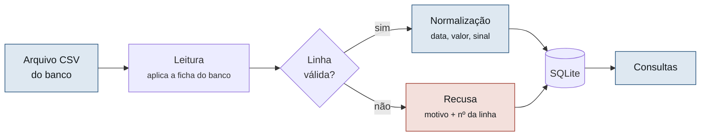
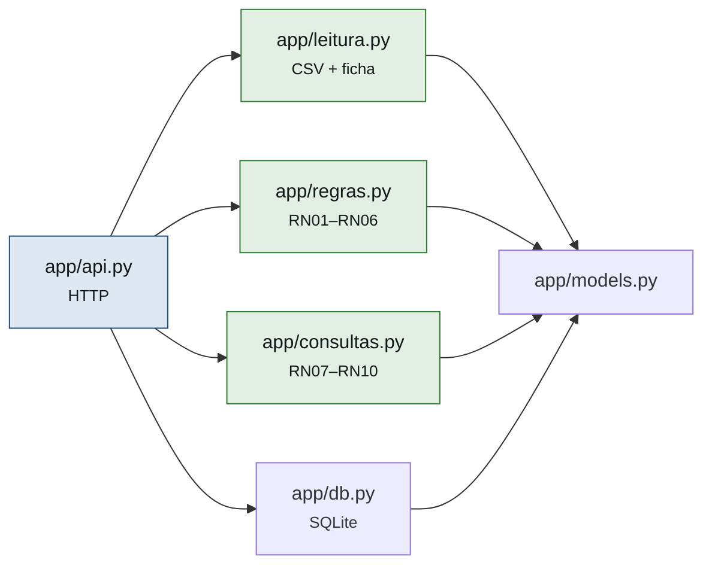

<div align="center">

# Statement Analyzer

**Envie um extrato bancário. Faça perguntas sobre ele.**

[](https://github.com/gustavo-lqt/statement-analyzer/releases/tag/v1.0.0)


</div>

Especificação técnica (as-built): **[`docs/SPEC.md`](docs/SPEC.md)** ·
Relatório técnico-ético: **[`docs/RELATORIO.md`](docs/RELATORIO.md)** ·
Versão estável: **[`v1.0.0`](https://github.com/gustavo-lqt/statement-analyzer/releases/tag/v1.0.0)**

---

## O projeto

O banco registra tudo que entrou e saiu da conta, mas entrega isso como um arquivo longo, com
descrições geradas por máquina (`PAG*MERC CENTRAL 03/09`) e sem nenhum resumo. Na prática
ninguém lê o próprio extrato, e perguntas simples ficam sem resposta.

Pior: não existe formato único de exportação — cada banco escreve data, valor decimal, sinal
de saída e nomes de coluna de um jeito.

**O Statement Analyzer resolve as duas coisas.** Você envia o arquivo, ele entende o formato
do banco pela ficha declarada, normaliza os lançamentos para um modelo único e passa a
responder consultas sobre eles.



Uma linha com defeito **não derruba o arquivo**: é recusada individualmente, com motivo e
número da linha, e a leitura continua (RN05).

---

## Funcionalidades

| Método | Rota | Descrição |
|:---|:---|:---|
| `POST` | `/extratos` | Envia o arquivo e devolve o resultado da leitura |
| `GET` | `/extratos` | Lista os extratos enviados |
| `GET` | `/extratos/{id}?limite=100&offset=0` | Detalhes do extrato e seus lançamentos, paginados |
| `DELETE` | `/extratos/{id}` | Apaga o extrato, seus lançamentos e suas recusas |

### Consultas

| Rota | Responde |
|:---|:---|
| `GET /extratos/{id}/resumo` | Entradas, saídas, saldo, média diária e período |
| `GET /extratos/{id}/saldo` | Saldo final, se ficou negativo, saldo mínimo e sua data |
| `GET /extratos/{id}/maior-entrada` | O maior valor que entrou (`null` se não houver entradas) |
| `GET /extratos/{id}/maior-despesa` | O maior valor que saiu (`null` se não houver despesas) |
| `GET /extratos/{id}/top-despesas?n=10` | As N maiores saídas (N de 1 a 100) |
| `GET /extratos/{id}/por-semana` | Entradas, saídas e saldo por semana, de segunda a domingo |
| `GET /extratos/{id}/dias-no-negativo` | Quantos dias no vermelho, e em quais períodos |
| `GET /extratos/{id}/repetidos` | Gastos que se repetem no período (RN09) |

Todo valor em dinheiro é um **inteiro em centavos** (`-148951` = R$ −1.489,51) e toda data
está no formato `AAAA-MM-DD`.

### Bancos suportados

Cada banco é descrito por uma ficha em [`app/fichas/`](app/fichas/). As três fichas são
sintéticas e, juntas, cobrem todas as convenções que o leitor sabe interpretar:

| Ficha | Delimitador | Encoding | Data | Decimal / milhar | Sinal da saída |
|:---|:---:|:---|:---|:---:|:---|
| `banco-a` | `;` | latin-1 | `dd/mm/aaaa` | `,` / `.` | valor negativo |
| `banco-b` | `,` | UTF-8 | `aaaa-mm-dd` | `.` / — | coluna `type` com `D` ou `C` |
| `banco-c` | `;` | UTF-8 | `dd-mm-aaaa` | `,` / `.` | colunas separadas de crédito e débito |

Adicionar um banco é adicionar uma ficha, sem alterar código (ADR-002).

### Recusas e erros

Uma linha que não casa com a ficha é recusada com um destes motivos: `DATA_INVALIDA` ·
`VALOR_INVALIDO` · `PRECISAO_INVALIDA` · `COLUNA_AUSENTE` · `LINHA_TRUNCADA` ·
`ENCODING_INVALIDO`. O sistema nunca adivinha uma data ambígua nem arredonda um valor com
três casas decimais (RN01, RN04).

Todo erro da API sai no mesmo formato (SPEC §6.6):

```json
{ "erro": "NENHUMA_LINHA_VALIDA", "mensagem": "Nenhuma linha válida foi encontrada.", "regra": "RN06" }
```

| Status | Erro |
|:---:|:---|
| `400` | `ARQUIVO_AUSENTE` · `BANCO_DESCONHECIDO` |
| `404` | `EXTRATO_NAO_ENCONTRADO` · `ROTA_INEXISTENTE` |
| `405` | `METODO_NAO_PERMITIDO` |
| `422` | `ARQUIVO_VAZIO` · `ENCODING_INVALIDO` · `NENHUMA_LINHA_VALIDA` · `PARAMETRO_INVALIDO` |
| `500` | `ERRO_INTERNO` (sem detalhes da exceção na resposta nem no log) |

### Fora do escopo

Categorização de gastos · metas e orçamento · comparação com despesas planejadas ·
Open Finance · múltiplas moedas · login e múltiplos usuários · interface web além do mínimo
para demonstração.

---

## Como executar

Pré-requisito: **Docker**. Nada mais precisa estar instalado.

```bash
git clone https://github.com/gustavo-lqt/statement-analyzer.git
cd statement-analyzer

docker compose up api            # API em http://localhost:8000 (documentação em /docs)
docker compose run --rm tests    # suíte de testes completa
```

O banco SQLite fica em `dados/statement.db`, numa pasta montada como volume. Os extratos
enviados continuam lá depois que o container para.

### Configuração

Não é preciso configurar nada para rodar com Docker: o `docker-compose.yml` já define tudo.

| Variável | Padrão | Para que serve |
|:---|:---|:---|
| `STATEMENT_DB` | `dados/statement.db` | Caminho do arquivo SQLite. No Docker, `/code/dados/statement.db` |

A API usa a porta `8000`. Se ela estiver ocupada, troque o lado esquerdo de
`"8000:8000"` no `docker-compose.yml` (por exemplo, `"8080:8000"`). Para começar com o banco
vazio, apague `dados/statement.db`.

Fora do Docker, defina a variável antes de subir a API:

```bash
export STATEMENT_DB=/tmp/statement.db      # no Windows (PowerShell): $env:STATEMENT_DB="C:\temp\statement.db"
```

### Testar com um extrato gerado

O repositório não tem nenhum extrato real (RNF05). Para testar, gere um extrato inventado
com o gerador. A mesma semente produz sempre o mesmo arquivo:

```bash
docker compose run --rm api python -m gerador.gerar \
  --banco banco-a --linhas 300 --semente 42 --invalidas 5 --saida dados/extrato-banco-a.csv
```

Com a API no ar, envie o arquivo e consulte. Também dá para fazer tudo pela página
`http://localhost:8000/docs`:

```bash
curl -F banco=banco-a -F saldo_inicial_centavos=150000 \
     -F arquivo=@dados/extrato-banco-a.csv http://localhost:8000/extratos

curl http://localhost:8000/extratos/1/resumo
curl http://localhost:8000/extratos/1/dias-no-negativo
```

<details>
<summary>Respostas obtidas com esse extrato</summary>

`POST /extratos` → `201`. As 5 linhas defeituosas foram recusadas, e as outras 295 entraram:

```json
{
  "id": 1, "nome_arquivo": "extrato-banco-a.csv", "banco": "banco-a",
  "criado_em": "2026-10-25T13:32:48-03:00", "saldo_inicial_centavos": 150000,
  "total_linhas": 300, "aceitos": 295, "rejeitados": 5,
  "recusas": [
    { "linha": 96, "motivo": "DATA_INVALIDA", "conteudo": "31/09/2026;CONTA ENERGIA;-210,52" },
    { "linha": 176, "motivo": "PRECISAO_INVALIDA", "conteudo": "18/09/2026;TRANSF PIX ENVIADA;-1.333,246" }
  ]
}
```

(lista de recusas resumida)

`GET /extratos/1/resumo` → `200`:

```json
{ "extrato_id": 1, "periodo": { "de": "2026-09-01", "ate": "2026-09-30" },
  "total_lancamentos": 295, "entradas_centavos": 5882702, "saidas_centavos": -5841199,
  "saldo_centavos": 41503, "media_diaria_gasto_centavos": -194706 }
```

`GET /extratos/1/dias-no-negativo` → `200`:

```json
{ "saldo_inicial_centavos": 150000, "saldo_inicial_assumido": false, "dias_no_negativo": 5,
  "periodos": [ { "de": "2026-09-25", "ate": "2026-09-29", "saldo_minimo_centavos": -502569 } ] }
```

</details>

### Sem Docker (desenvolvimento)

Com Python 3.12:

```bash
python -m venv .venv
source .venv/bin/activate        # no Windows: .venv\Scripts\activate
pip install -r requirements.txt

uvicorn app.api:app --reload     # API em http://localhost:8000
python -m pytest -q              # testes
```

O banco fica no caminho da variável `STATEMENT_DB` (ver [Configuração](#configuração)).
Antes de abrir um PR, a suíte tem que passar também no Docker (ADR-006).

---

## Arquitetura

As dependências apontam para dentro: a camada HTTP conhece o motor, e o motor não conhece
HTTP nem banco de dados (ADR-001).



| Módulo | Papel | Restrição |
|:---|:---|:---|
| `app/models.py` | Entidades: `Extrato`, `Lancamento`, `Recusa`, `FichaBanco` | só dados |
| `app/leitura.py` | Abre o CSV em streaming e aplica a ficha | sem FastAPI e sem banco |
| `app/regras.py` | Normaliza e valida cada linha (RN01–RN06) | motor puro: sem I/O |
| `app/consultas.py` | As oito consultas (RN07–RN10) | motor puro: sem I/O |
| `app/db.py` | Toda a persistência SQLite, em transação única | único lugar com SQL |
| `app/api.py` | Rotas, validação HTTP e formato único de erro | sem regra de negócio |
| `gerador/` | Extratos sintéticos e determinísticos | — |

As restrições não dependem só de revisão: `tests/test_arquitetura.py` lê o código-fonte e
reprova o PR se o motor importar FastAPI, `sqlite3` ou `app.db`, ou se aparecer SQL fora de
`app/db.py`.

---

## Testes

```bash
docker compose run --rm tests
```

| Arquivo | Testes | O que cobre |
|:---|---:|:---|
| `tests/test_regras.py` | 45 | Normalização e validação, RN01–RN06 |
| `tests/test_consultas.py` | 55 | As oito consultas, RN07–RN10 |
| `tests/test_leitura.py` | 63 | Leitura do CSV pela ficha, inclusive 100 mil linhas em streaming (RNF04) |
| `tests/test_gerador.py` | 46 | Gerador de extratos sintéticos |
| `tests/test_db.py` | 9 | Persistência, cascata e rollback |
| `tests/test_api.py` | 51 | Contratos HTTP da SPEC §6, inclusive todos os erros da §6.6 |
| `tests/test_arquitetura.py` | 13 | Guarda de arquitetura (ADR-001) |
| **Total** | **282** | cobertura de 99% em `app/` e `gerador/` |

O mesmo comando mostra a cobertura de cada módulo:

| Módulo | Cobertura | Módulo | Cobertura |
|:---|---:|:---|---:|
| `app/regras.py` | 95% | `app/api.py` | 99% |
| `app/consultas.py` | 100% | `app/db.py` | 94% |
| `app/leitura.py` | 99% | `gerador/gerar.py` | 100% |

A RNF07 pede 80% em `app/regras.py` e `app/consultas.py`. Cada teste tem uma docstring que
cita a regra ou o contrato que verifica, e cada regra tem pelo menos um teste do cenário
principal e um de caso de borda (rastreabilidade na SPEC §7).

---

## Colaboração com IA

O projeto segue **SDD (Spec-Driven Development)**: a [`docs/SPEC.md`](docs/SPEC.md) foi
escrita primeiro, e o agente de IA implementa a partir dela. O agente é regido pelo
[`CLAUDE.md`](CLAUDE.md), que o obriga a seguir a SPEC, a respeitar a arquitetura e a parar
para propor uma mudança na SPEC quando faltar alguma definição.

**Ferramenta:** Claude Code (Claude Opus 5.5), em parte com o plugin Superpowers, que
conduz o trabalho por plano, TDD e verificação. Cada integrante registra a ferramenta que
usou no seu arquivo de [`docs/prompts/`](docs/prompts/).

**Como o trabalho foi dividido:** antes de começar, o grupo combinou as interfaces entre os
módulos num contrato ([`docs/tarefas/CONTRATO.md`](docs/tarefas/CONTRATO.md)). Com isso,
os cinco integrantes trabalharam em paralelo, cada um em uma branch e com um único dono por
arquivo. Cada um recebeu a sua tarefa e o prompt para a IA em
[`docs/tarefas/`](docs/tarefas/). As decisões tomadas nesse planejamento (D1–D7) estão na
§8 da SPEC.

**Revisão:** todo código gerado entra por Pull Request na branch `entrega`, com a aprovação
de outro integrante. `main` e `entrega` são protegidas: ninguém faz push direto, nem o
administrador.

**Registros:** em [`docs/prompts/`](docs/prompts/), cada integrante registra os prompts que
usou, os erros da IA e o que precisou corrigir.

<details>
<summary>Exemplo de prompt usado e resultado obtido</summary>

Na revisão do PR #18 (motor de normalização), um teste manual mostrou que
`converter_valor("1²")` levantava `ValueError`. O `str.isdigit()` do Python aceita `²` como
dígito, mas o `int()` não consegue converter. Pela API, um upload com essa linha devolvia
erro 500 no arquivo inteiro, contra a RN05. Os testes gerados pela IA não tinham pegado o
caso. Trecho do prompt de correção:

```
Bug: converter_valor usa str.isdigit() e converter_data usa \d na regex. Os dois aceitam
qualquer dígito Unicode, não só 0-9. [...]
Correção esperada:
- Em converter_valor, aceite só dígitos ASCII (x.isascii() and x.isdigit()).
- Em converter_data, troque \d por [0-9] nos três padrões.
Primeiro escreva os testes de regressão e veja que falham; depois corrija. [...]
```

**Resultado:** 7 testes de regressão novos (RN01, RN02 e RN05) e a correção em
`app/regras.py`. O mesmo upload passou a devolver `201`, com a linha recusada como
`VALOR_INVALIDO`. Prompt completo em [`docs/prompts/felipe.md`](docs/prompts/felipe.md).
</details>

---

## Decisões arquiteturais (ADRs)

### ADR-001 — Regras de negócio isoladas da camada HTTP

**Contexto:** precisamos testar as regras rapidamente e poder trocar a camada de apresentação
nas próximas entregas. Testes que sobem servidor são lentos e frágeis.
**Decisão:** motor puro em `app/regras.py` e `app/consultas.py`, proibidos de importar FastAPI
ou fazer I/O; `app/api.py` apenas traduz HTTP.
**Consequências:** a maior parte dos testes roda em milissegundos, sem rede. Em troca, exige
disciplina para nenhuma dependência de HTTP vazar para dentro do motor, verificada
automaticamente por `tests/test_arquitetura.py`.

### ADR-002 — Fichas de banco declarativas em JSON

**Contexto:** três bancos na v1.0.0, cada um com colunas, separadores, encoding e convenção de
sinal diferentes — e mais bancos depois. Condicionais no núcleo tornariam cada banco novo um
risco para os já existentes.
**Decisão:** o formato de cada banco é um arquivo JSON em `app/fichas/`, consumido por um
leitor único.
**Consequências:** adicionar um banco é adicionar dado, não código, e os testes dos bancos
existentes seguem válidos. Formatos que não caibam no vocabulário da ficha exigirão estender o
esquema.

### ADR-003 — Valores monetários em centavos inteiros

**Contexto:** ponto flutuante introduz erro de arredondamento (`0.1 + 0.2 = 0.30000000000000004`),
inaceitável em sistema cujo propósito é conferência.
**Decisão:** inteiro em centavos em todo o fluxo, do parser ao JSON de resposta.
**Consequências:** soma e comparação exatas, e SQLite armazena inteiros nativamente. A
formatação para exibição fica na borda, a cargo do cliente da API.

### ADR-004 — Persistência em SQLite

**Contexto:** o sistema é monousuário por escopo e o volume é de milhares de linhas. Postgres
somaria um serviço ao compose, espera de readiness e limpeza de tabelas entre testes.
**Decisão:** SQLite em arquivo, com banco em memória nos testes.
**Consequências:** um serviço a menos e testes rápidos e isolados. Se o sistema virar
multiusuário será preciso migrar — o acesso a dados está isolado em `app/db.py` para tornar
isso viável.

### ADR-005 — Recusar a linha em vez de adivinhar o formato

**Contexto:** `03/04/2026` pode ser 3 de abril ou 4 de março; valor com três casas decimais
pode ser erro de exportação ou precisão real. Uma heurística acertaria em alguns arquivos e
erraria em silêncio em outros.
**Decisão:** recusar a linha, registrando motivo e número, sempre que o dado não casar com a
ficha declarada.
**Consequências:** o sistema falha de forma visível e auditável em vez de produzir números
errados — aceitável porque o propósito é conferência. O custo é exigir ficha correta antes da
primeira leitura.

### ADR-006 — Docker como ambiente de referência, não de desenvolvimento

**Contexto:** cinco integrantes em sistemas operacionais diferentes, e o projeto depende de
encoding, locale e interpretação de data — exatamente o que varia entre máquinas.
**Decisão:** desenvolvimento local com dependências travadas; Docker obrigatório antes de
abrir PR e na entrega.
**Consequências:** ciclo rápido no dia a dia e reprodutibilidade verificável na entrega. Exige
manter as duas definições de dependência em sincronia.

---

## Evidências e entrega

- **Testes:** log da última execução da suíte, com a cobertura por módulo, em
  [`logs_testes.txt`](logs_testes.txt), gerado com
  ```bash
  docker compose run --rm tests | tee logs_testes.txt
  ```
- **Release:** [`v1.0.0`](https://github.com/gustavo-lqt/statement-analyzer/releases/tag/v1.0.0),
  com as mudanças em [`CHANGELOG.md`](CHANGELOG.md).
- **Relatório técnico-ético e de encerramento:** [`docs/RELATORIO.md`](docs/RELATORIO.md),
  com a governança, os erros corrigidos, o loop de re-especificação, a análise das
  ferramentas de IA e a retrospectiva.

---

## Equipe

| Integrante | RA | Parte do sistema | Issues |
|---|:---|:---|:---|
| Diego de Souza | 22352472 | Leitura do CSV pela ficha e gerador de extratos | #2, #11, #4 |
| Felipe Marinho | 22353607 | Motor de normalização (RN01–RN06) | #12, #3 |
| Gustavo Lourenço | 22350665 | Base compartilhada, API HTTP, guarda de arquitetura e integração | #1, #9, #7 |
| Italo Henrique Lins Carneiro | 22350066 | As oito consultas de análise (RN07–RN10) | #10 |
| João Caio Dutra Gontijo | 22352975 | Persistência SQLite e Docker | #8, #6, #5 |

A divisão de tarefas também está nas [Issues](../../issues), com responsável atribuído em
cada uma. As unidades do sistema estão descritas em [`docs/SPEC.md`](docs/SPEC.md) §7.

---

<div align="center">

Projeto acadêmico — **Bootcamp III**, Turma B<br>
Centro Universitário de Brasília (CEUB) — 2026/2<br>

</div>
